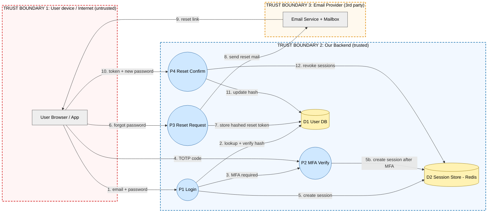
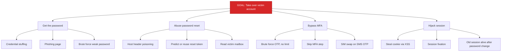

# Threat Model 1: Login + Password Reset + MFA

## 1. System Description
Web + mobile app. Users log in with email + password, optional TOTP(time based one time password) MFA. "Forgot password" sends a reset link by email. Sessions live in Redis, users in a SQL DB. Email provider is third party.

## 2. Assets
- Passwords / hashes
- Session tokens
- Reset tokens
- MFA secrets, backup codes
- User PII, and the account itself

## 3. DFD with Trust Boundaries

## 4. STRIDE per Element

| Element             | Type     |  S  |  T  |  R  |  I  |  D  |  E  | Threat                                                                        |
| ------------------- | -------- | :-: | :-: | :-: | :-: | :-: | :-: | ----------------------------------------------------------------------------- |
| User Browser / App  | External |  ✔  |     |  ✔  |     |     |     | Phishing, password reuse, user denies actions                                 |
| Flow 1 (creds)      | Flow     |     |  ✔  |     |  ✔  |  ✔  |     | Sniffing / TLS downgrade, login flood                                         |
| P1 Login            | Process  |  ✔  |  ✔  |  ✔  |  ✔  |  ✔  |  ✔  | Credential stuffing, user enumeration, no audit log, lockout DoS, SQLi bypass |
| P2 MFA Verify       | Process  |  ✔  |  ✔  |     |     |  ✔  |  ✔  | OTP brute force, skip MFA step, response tampering                            |
| P3 Reset Request    | Process  |  ✔  |  ✔  |     |  ✔  |  ✔  |     | Host header poisoning, enumeration, email bombing                             |
| P4 Reset Confirm    | Process  |  ✔  |  ✔  |  ✔  |     |     |  ✔  | Weak/reusable token, sessions not revoked                                     |
| D1 User DB          | Store    |     |  ✔  |  ✔  |  ✔  |  ✔  |     | Hash theft (SQLi/insider), tampered reset tokens                              |
| D2 Session Store    | Store    |  ✔  |  ✔  |     |  ✔  |  ✔  |     | Session theft/forgery, Redis open without auth                                |
| Flow 9 (reset link) | Flow     |     |  ✔  |     |  ✔  |     |     | Token leaks via mailbox, Referer, logs                                        |
| Email Provider      | External |  ✔  |     |  ✔  |  ✔  |     |     | Provider sees reset links, compromise = takeover                              |

## 5. Attack Tree: Account Takeover

*All branches are OR: any one path is enough.*

## 6. Mitigations

| Threat                            | Mitigation                                                                                               |
| --------------------------------- | -------------------------------------------------------------------------------------------------------- |
| Credential stuffing / brute force | Rate limit per IP + per account, CAPTCHA after N fails, breached-password check, MFA                     |
| User enumeration                  | Same generic message and response time everywhere                                                        |
| Weak reset token                  | 128-bit CSPRNG token, store only its hash, 15 min expiry, single use                                     |
| MFA bypass                        | Enforce MFA state server-side on every route, OTP attempt cap + expiry, prefer TOTP/WebAuthn over SMS    |
| Session issues                    | Rotate session ID on login, revoke all sessions on password change, HttpOnly + Secure + SameSite cookies |

