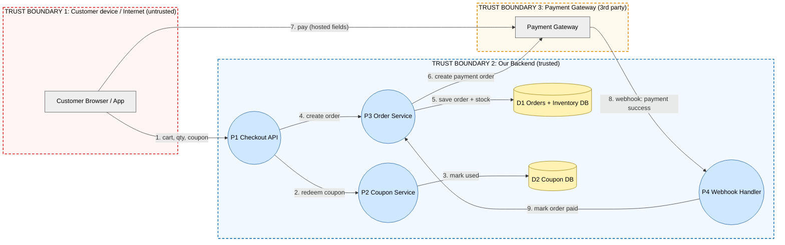
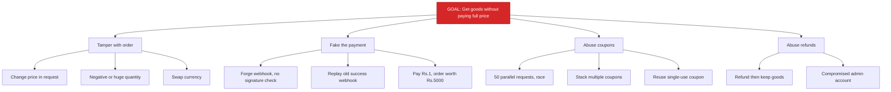

# Threat Model 2: E-commerce Checkout + Payment (UPI / Card)

## 1. System Description
Customer adds items, applies a coupon, pays through a payment gateway (hosted card/UPI fields). The gateway sends a webhook when payment succeeds, then the order is fulfilled.

## 2. Assets
- Money (orders, refunds)
- Card / UPI data and payment tokens
- Order and customer data
- Inventory and coupon budget
- Gateway API keys + webhook secret

## 3. DFD with Trust Boundaries

## 4. STRIDE per Element

| Element | Type | S | T | R | I | D | E | Threat |
|---|---|:-:|:-:|:-:|:-:|:-:|:-:|---|
| Customer | External | ✔ | | ✔ | | | | Stolen account / cards, carding bots, "I never ordered this" |
| Flow 1 (cart) | Flow | | ✔ | | ✔ | | | Price / qty / currency tampering |
| P1 Checkout API | Process | ✔ | ✔ | ✔ | ✔ | ✔ | ✔ | Trusts client price, IDOR on orders, card data in logs, bot flood |
| P2 Coupon Service | Process | | ✔ | | | ✔ | ✔ | Coupon stacking, race condition, reuse |
| P3 Order Service | Process | | ✔ | ✔ | | | ✔ | Amount mismatch, double processing, refund abuse |
| P4 Webhook Handler | Process | ✔ | ✔ | ✔ | | ✔ | | Forged webhook, replayed webhook, no signature check |
| D1 Orders + Inventory DB | Store | | ✔ | ✔ | ✔ | ✔ | | Order tampering, PII leak, stock race |
| D2 Coupon DB | Store | | ✔ | | | ✔ | | Double redemption, coupon list leak |
| Flow 7 (payment) | Flow | | ✔ | | ✔ | | | Card data touching our servers, redirect tampering |
| Flow 8 (webhook) | Flow | ✔ | ✔ | | | | | Fake "payment success" call |
| Payment Gateway | External | ✔ | | ✔ | ✔ | ✔ | | Gateway outage, key leak, dispute / chargeback |

## 5. Attack Tree: Get Goods Without Paying Full Price

*All branches are OR.*

## 6. Mitigations

| Threat                           | Mitigation                                                                        |
| -------------------------------- | --------------------------------------------------------------------------------- |
| Price / qty tampering            | Server recalculates total from DB prices, validate qty range                      |
| Forged webhook                   | Verify HMAC signature with gateway secret, optionally allowlist gateway IPs       |
| Amount mismatch                  | Compare webhook amount + currency to order, confirm via gateway fetch-payment API |
| Coupon race / reuse              | Atomic redeem (UNIQUE constraint + conditional UPDATE), one coupon per order      |
| IDOR on orders                   | Scope queries by owner: `WHERE id=? AND user_id=?`                                |
| Card data exposure               | Hosted fields / tokenization, never log PAN                                       |
| Refund abuse                     | Dual approval above a limit, RBAC, immutable audit log                            |
