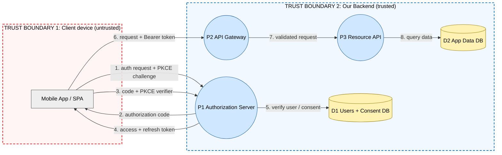
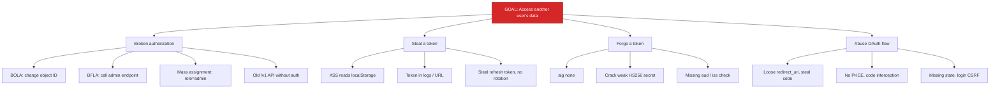

# Threat Model 3: REST API with JWT / OAuth 2.0

## 1. System Description
Mobile app / SPA calls a REST API. Login goes through an OAuth 2.0 / OIDC authorization server (Authorization Code + PKCE). The API gateway validates the JWT access token, the resource API reads the DB.

## 2. Assets
- Access / refresh tokens, signing keys
- User data behind the API
- Client secrets, scopes, consent records
- API availability

## 3. DFD with Trust Boundaries

## 4. STRIDE per Element

| Element | Type | S | T | R | I | D | E | Threat |
|---|---|:-:|:-:|:-:|:-:|:-:|:-:|---|
| Mobile App / SPA | External | ✔ | ✔ | ✔ | ✔ | | | Token stored insecurely (localStorage), reverse-engineered secrets, user denies actions |
| Flow 1-3 (OAuth) | Flow | ✔ | ✔ | | ✔ | | | Code interception (no PKCE), loose redirect_uri, missing state |
| Flow 4 (tokens) | Flow | ✔ | | | ✔ | | | Token theft, tokens in logs / URL |
| P1 Authorization Server | Process | ✔ | ✔ | ✔ | ✔ | ✔ | ✔ | Refresh token reuse, over-broad scopes, client impersonation |
| P2 API Gateway | Process | ✔ | ✔ | | | ✔ | ✔ | JWT alg none / weak key / no exp / no aud check, no rate limit |
| P3 Resource API | Process | ✔ | ✔ | ✔ | ✔ | ✔ | ✔ | BOLA, BFLA, mass assignment, excessive data in response |
| D1 Users + Consent DB | Store | | ✔ | ✔ | ✔ | | | Consent tampering, credential leak |
| D2 App Data DB | Store | | ✔ | ✔ | ✔ | ✔ | | Cross-user data access, injection, expensive queries |

## 5. Attack Tree: Access Another User's Data

*All branches are OR.*

## 6. Mitigations

| Threat | Mitigation |
|---|---|
| BOLA | Check ownership on every object access, scope queries by owner |
| BFLA | Central authorization (RBAC/ABAC), deny by default |
| JWT forgery | Pin algorithm, strong key or RS256 with rotation, validate exp / iss / aud, short TTL |
| Token theft | HttpOnly cookie or secure OS storage, strict CSP, never log tokens |
| OAuth flaws | Auth Code + PKCE only, exact-match redirect_uri, validate state |
| Refresh token theft | Rotation + reuse detection, revoke on logout |
| Mass assignment / data exposure | Response DTOs with allowlisted fields, schema validation rejecting unknown fields |
| No rate limiting | Per user / key / IP limits, pagination caps, query cost limits |
| Old API versions | API inventory, retire old versions, same auth everywhere |
