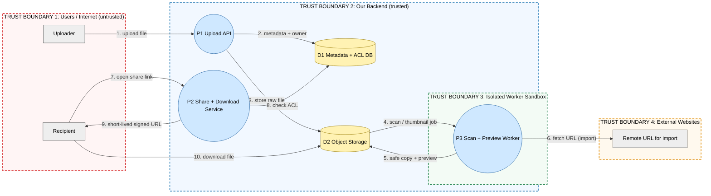
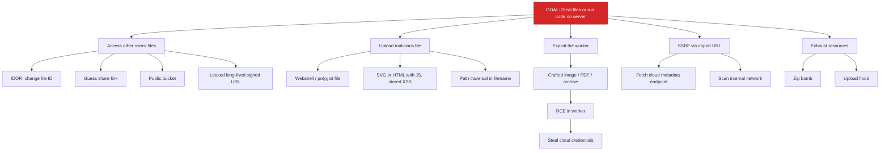

# Threat Model 4: File Upload + Sharing Service (Google Drive style)

## 1. System Description
Users upload files and share them by link. Files go to object storage; a worker scans them and makes previews; recipients download through short-lived signed URLs. Optional "import from URL" feature.

## 2. Assets
- User files
- Share links, signed URLs, ACLs
- Storage and compute budget
- Platform reputation (must not host malware)

## 3. DFD with Trust Boundaries

## 4. STRIDE per Element

| Element | Type | S | T | R | I | D | E | Threat |
|---|---|:-:|:-:|:-:|:-:|:-:|:-:|---|
| Uploader | External | ✔ | | ✔ | | | | Stolen session shares files out, uploader denies abuse |
| Recipient | External | ✔ | | ✔ | ✔ | | | Guessed / leaked link, forwarded link |
| Flow 1 (upload) | Flow | | ✔ | | | ✔ | | Malicious content, zip bomb, huge file flood |
| P1 Upload API | Process | ✔ | ✔ | ✔ | ✔ | ✔ | ✔ | Path traversal in filename, type spoofing, no quota |
| P2 Share + Download | Process | ✔ | ✔ | ✔ | ✔ | ✔ | ✔ | IDOR on file ID, weak link tokens, long-lived signed URLs |
| P3 Scan + Preview Worker | Process | | ✔ | | ✔ | ✔ | ✔ | Parser exploit (image/PDF/archive) leads to RCE and cloud creds |
| D1 Metadata + ACL DB | Store | | ✔ | ✔ | ✔ | | | ACL tampering, cross-tenant query bug |
| D2 Object Storage | Store | | ✔ | | ✔ | ✔ | | Public bucket, stored XSS via SVG/HTML, undeleted files |
| Flow 6 (import URL) | Flow | | | | ✔ | | ✔ | SSRF to internal services / cloud metadata |
| Remote URL | External | ✔ | ✔ | | | | | Malicious redirect, hostile content |

## 5. Attack Tree: Steal Files or Run Code on Server

*Branches are OR. The C1 to C3 chain is sequential: each step needs the one before.*

## 6. Mitigations

| Threat | Mitigation |
|---|---|
| IDOR / broken ACL | Authorize every file operation server-side, scope queries by owner / tenant |
| Guessable links | 128-bit random tokens, optional expiry + password, revoke button |
| Malicious file | Extension allowlist + magic byte check, random server-side names, AV scan before sharing |
| Stored XSS | Serve user content from a separate domain, `Content-Disposition: attachment`, `nosniff`, CSP sandbox |
| Parser exploit | Sandboxed worker (no network, low privilege, seccomp, CPU/mem/time limits), patch libraries |
| SSRF | Allowlist, block private/link-local IPs, no redirects, isolated egress |
| Path traversal | Never use user filename on disk (`secure_filename` + random name) |
| DoS | Size limits, per-user quotas, rate limits, decompression ratio / depth limits |
| Bucket exposure | Block Public Access, short-lived signed URLs, access logging |
| Leftover data | Soft delete then hard delete job, strip EXIF |
