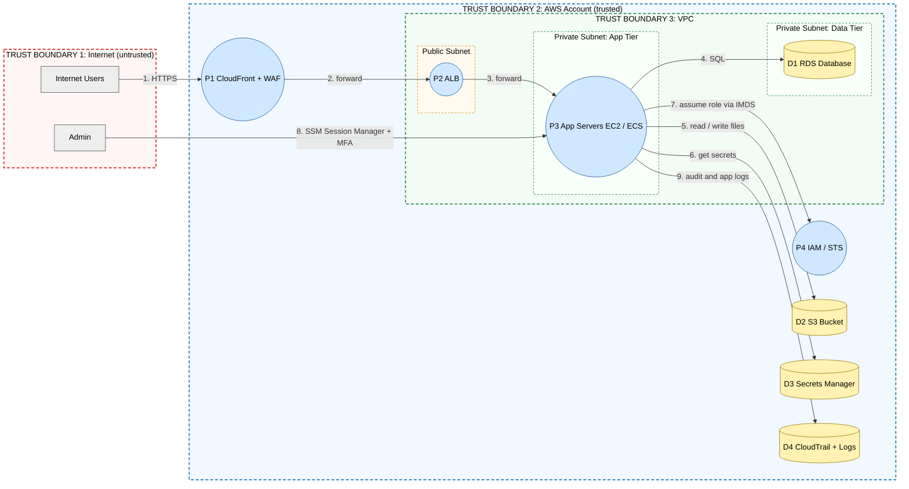
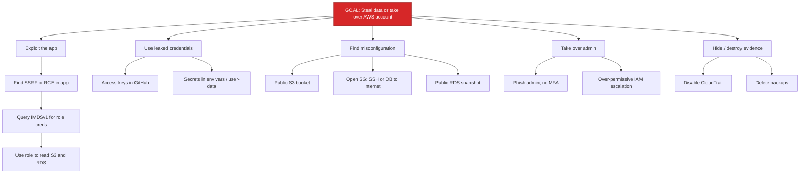

# Threat Model 5: 3-Tier Web App on AWS

## 1. System Description
CloudFront + WAF at the edge, ALB in a public subnet, app servers (EC2/ECS) in a private subnet, RDS in an isolated data subnet. S3 for files, Secrets Manager for credentials, CloudTrail for audit logs. Admins connect through SSM Session Manager.

## 2. Assets
- Customer data in RDS and S3
- IAM roles, access keys, secrets
- Application availability
- The AWS account itself

## 3. DFD with Trust Boundaries

## 4. STRIDE per Element

| Element | Type | S | T | R | I | D | E | Threat |
|---|---|:-:|:-:|:-:|:-:|:-:|:-:|---|
| Internet Users | External | ✔ | | ✔ | | | | Bots, scanners, anonymous attackers |
| Admin | External | ✔ | | ✔ | | | | No MFA, phished admin, leaked access keys |
| P1 CloudFront + WAF | Process | | ✔ | | | ✔ | | WAF bypass, DDoS, cache poisoning |
| P2 ALB | Process | | ✔ | | ✔ | ✔ | | Weak TLS config, direct-to-origin bypass of WAF |
| P3 App Servers | Process | ✔ | ✔ | ✔ | ✔ | ✔ | ✔ | App vuln, SSRF to IMDSv1, vulnerable AMI / image, open SG |
| P4 IAM / STS | Process | ✔ | ✔ | ✔ | | | ✔ | Over-permissive role (`*:*`), iam:PassRole abuse, long-lived keys |
| D1 RDS | Store | | ✔ | ✔ | ✔ | ✔ | | Public snapshot, DB reachable from internet, unencrypted |
| D2 S3 Bucket | Store | | ✔ | | ✔ | ✔ | | Public bucket, no versioning, ransomware delete |
| D3 Secrets Manager | Store | | | | ✔ | | | Secrets read by over-broad role, secrets in env / user-data |
| D4 CloudTrail + Logs | Store | | ✔ | ✔ | | | | Logging disabled, logs deletable, no integrity validation |
| Flow 4 (SQL) | Flow | | ✔ | | ✔ | | | Flat network, no TLS to DB |
| Flow 8 (admin access) | Flow | ✔ | | ✔ | | | | Open SSH 22 to 0.0.0.0/0, shared bastion keys |

## 5. Attack Tree: Steal Customer Data / Take Over Account

*Branches are OR. The A1 to A3 chain is sequential: each step needs the one before.*

## 6. Mitigations

| Threat | Mitigation |
|---|---|
| Over-permissive IAM | Least privilege, one role per service, permission boundaries, IAM Access Analyzer, no long-lived keys |
| SSRF to IMDS | Enforce IMDSv2 (hop limit 1), fix SSRF in the app, restrict egress |
| Public S3 / snapshots | S3 Block Public Access at account level, bucket policies, SSE-KMS, Macie |
| Open security groups | SG rules by source SG, no inbound SSH (use SSM), DB only from app SG |
| Secrets in code / env | Secrets Manager / Parameter Store, secret scanning in CI, rotation |
| Admin takeover | MFA on root and all humans, SSO, SCPs, locked-away break-glass account |
| No logging | CloudTrail in all regions with log validation, GuardDuty, Config rules, alerts |
| Flat network | Per-tier subnets and SGs, VPC endpoints, no internet route for data tier |
| Vulnerable app / image | WAF managed rules, patch pipeline, ECR image scanning, SAST/DAST |
| Ransomware / deletion | Automated backups, cross-account copy, S3 Object Lock, restore drills |
