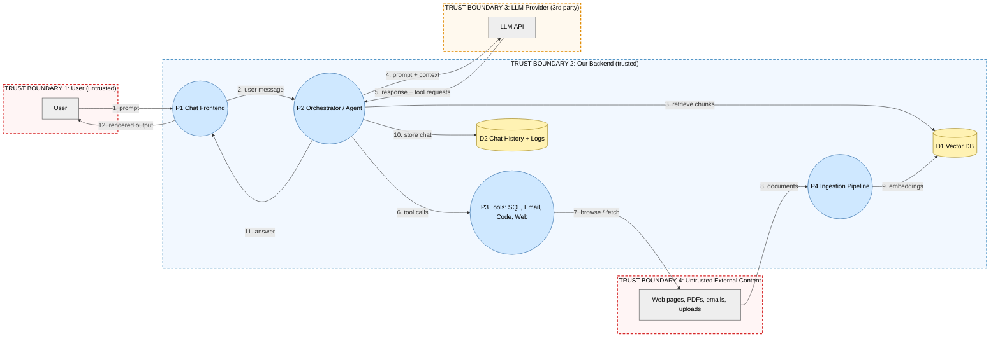
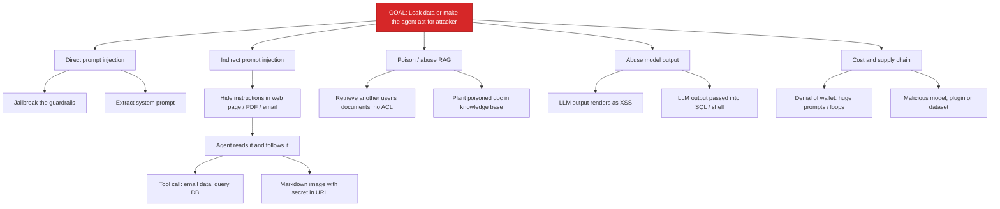

# Threat Model 6: LLM App (RAG Chatbot with Tools)

## 1. System Description
Chatbot backend takes a user prompt, retrieves documents from a vector DB (RAG), calls an LLM API, and may call tools (SQL, email, code execution, web). Documents are ingested from internal files and external content. Chat history is stored.

## 2. Assets
- Knowledge base and chat history (sensitive data)
- System prompt, API keys, tool credentials
- What the tools can do (send email, run queries)
- Model API budget and availability

## 3. DFD with Trust Boundaries

## 4. STRIDE per Element

| Element | Type | S | T | R | I | D | E | Threat |
|---|---|:-:|:-:|:-:|:-:|:-:|:-:|---|
| User | External | ✔ | | ✔ | | | | Jailbreak attempts, injected text pretending to be "system" |
| P1 Chat Frontend | Process | | ✔ | | ✔ | | | LLM output rendered as HTML / markdown (XSS, image exfiltration) |
| P2 Orchestrator / Agent | Process | ✔ | ✔ | ✔ | ✔ | ✔ | ✔ | Prompt injection, system prompt leak, endless agent loops, no per-user limits |
| P3 Tools | Process | ✔ | ✔ | ✔ | ✔ | | ✔ | Excessive agency: injected text triggers email / SQL / code with broad creds |
| P4 Ingestion Pipeline | Process | | ✔ | | | | | Poisoned documents enter the knowledge base |
| D1 Vector DB | Store | | ✔ | | ✔ | | | No ACL on retrieval (cross-user leak), poisoned chunks, embedding inversion |
| D2 Chat History + Logs | Store | | | ✔ | ✔ | | | PII / secrets stored in logs, no record of which prompt caused a tool call |
| LLM API | External | | | | ✔ | ✔ | | Data sent to provider, outage, malicious or swapped model |
| Web / PDFs / emails | External | ✔ | ✔ | | | | | Hidden instructions (indirect prompt injection) |
| Flow 5 (tool requests) | Flow | ✔ | ✔ | | | | ✔ | Model output treated as trusted command |
| Flow 12 (rendered output) | Flow | | ✔ | | ✔ | | | Secrets leaked in image URL / link query string |

## 5. Attack Tree: Make the App Leak Data or Act for the Attacker

*Branches are OR. The B1 to B3/B4 chain is sequential: each step needs the one before.*

## 6. Mitigations

| Threat | Mitigation |
|---|---|
| Prompt injection (direct + indirect) | No perfect fix, so layer: separate instructions from untrusted data, label retrieved content, filters on input/output, and assume the model can be tricked |
| Excessive agency | Least privilege per tool, read-only by default, per-user scoped credentials, human approval for send / delete / pay |
| Cross-user RAG leakage | ACL-aware retrieval: filter by user / tenant before the LLM sees anything, per-tenant indexes |
| Improper output handling | Treat LLM output as untrusted input: encode for HTML, parameterize SQL, never eval / shell it, validate structured output with a schema |
| Markdown / link exfiltration | Block or proxy external images and links, CSP `img-src` allowlist, strip URLs with query data |
| Data poisoning | Vet and sign data sources, review ingestion, monitor retrieval for anomalies |
| System prompt leakage | Never put secrets or authorization logic in the prompt, assume it is public |
| Cost / DoS | Per-user rate and token limits, max output length, agent step limits, budget alerts |
| Supply chain | Pin and verify model / package hashes, SBOM, trusted registries only |
| Visibility | Log prompts, retrieved chunks, tool calls (with redaction), red-team regularly |
